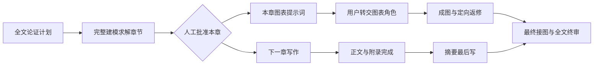
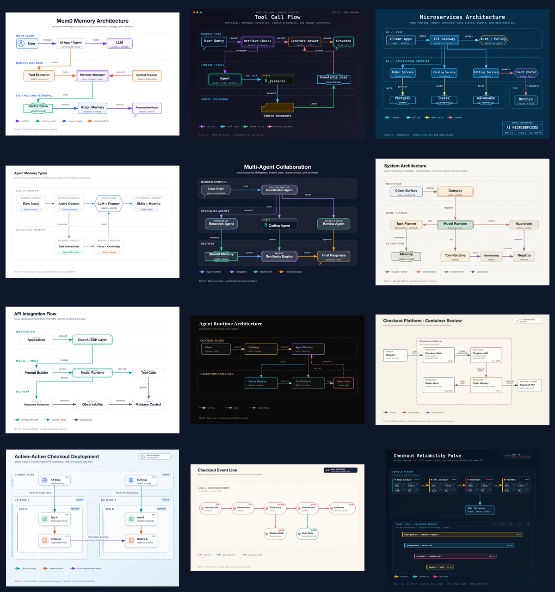

# 数模军械库 · MathModeling Skills Arsenal

把读题、建模求解、科研绘图、论文写作与终稿检查组织成可追溯的 AI Agent 工作流。

[](https://github.com/hua695/MathModeling-Skills-Arsenal/actions/workflows/validate.yml)
[](LICENSE)

适合已有题目、数据和人工判断，希望让 AI 分工、证据和交付更清楚的建模团队。覆盖国赛、美赛、MathorCup 等竞赛；具体格式与 AI 使用要求以本届官方规则为准。

**先看效果：** [逐章写作示例](examples/chapter-parallel/README.md) · [可复制提示词](docs/quickstart.md) · [验证与边界](docs/validation.md) · [完整技能目录](docs/skill-catalog.md)

## 能得到什么

| 你的任务 | 主要技能 | 可检查的产出 |
| --- | --- | --- |
| 组织完整参赛流程 | `contest-orchestrator` | 问题划分、模型计划、实验记录、任务卡、人工批准与交付检查 |
| 选择模型与处理数据 | `math-model-selector`、`data-science-stack` | 模型选择表、数据协议、baseline、公平比较与独立核验材料 |
| 写出有论证的章节 | `academic-writing` | 读者问题、完整章节、符号与主张证据审阅；普通润色保护公式和数字 |
| 制作论文数据图 | `scipilot-figure-skill`、`modelviz` | 图表决策卡、模板适配脚本、SVG/PNG 和视觉 QA |
| 画流程、技术路线与机制图 | `tikz-scientific-figures` | 可编辑 TikZ 源与 SVG/PNG |
| 排版和交稿前复查 | `mathmodel-latex-skill`、`bzd-review-paper` | 论文工程、编译与一致性检查、问题清单与评审报告 |

这些是工作流和工具能力，不构成获奖、预测精度或论文质量保证。真实结论仍需要实际数据、实验与人工核验。

## 本次更新：章节批准后，图文并行

Harness 与 MathorCup 的新模板采用 `chapter_parallel`。先写建模求解，目录顺序与实际写作顺序分别维护。每次提交完整一章，由使用者批准后再写下一章；图表提示词也在该章批准后产生，由使用者转交图表角色。



图件返修更新提示词版本，后续章节继续写；未变正文的批准保持有效。最终交付仍检查最新图件、选定版本、证据来源与全文一致性。历史四批写作记录继续兼容。

## 三分钟开始

```bash
git clone https://github.com/hua695/MathModeling-Skills-Arsenal.git
cd MathModeling-Skills-Arsenal
```

仓库使用 `skills/<分类>/<技能>/SKILL.md` 结构，安装时将技能目录放到宿主实际读取的技能根目录。以 Codex 用户技能目录为例：

```powershell
# PowerShell：只安装数模分类，跳过创意写作。
$skillRoot = Join-Path $env:USERPROFILE '.agents/skills'
New-Item -ItemType Directory -Force -Path $skillRoot | Out-Null
Get-ChildItem skills/0* -Directory | ForEach-Object {
    Get-ChildItem $_.FullName -Directory | ForEach-Object {
        Copy-Item -LiteralPath $_.FullName -Destination $skillRoot -Recurse
    }
}
```

已有同名技能时先比较与备份，再合并。Claude Code、WorkBuddy 等宿主使用各自配置的技能目录；支持 `SKILL.md` 不代表工具、模型和多角色能力完全相同。

安装后打开新会话，给出题目、附件路径与规则来源：

```text
使用 contest-orchestrator。先读取我的题目和本届规则，列出缺失输入，
选择合适模式。先做题意与模型计划，不直接生成最终论文或编造实验结果。
```

MathorCup 全流程可指定 `full-contest-mathorcup`；只解一问、只画图或只审稿时使用对应单项技能。详见 [启动示例](docs/quickstart.md)。

## 如何判断效果

- **流程验证：** 正反例测试检查提前派发、输入哈希漂移、旧图版本等是否被拒绝。
- **输出示例：** [合成章节与图表交接](examples/chapter-parallel/README.md) 展示输入、正文、批准边界与提示词，附可运行的数据计算。
- **视觉样例：** 下图是已有 `fireworks-tech-graph` 的上游风格资源，不代表本次生成的科研结果图。科研数据图走 SciPilot / ModelViz，竞赛非数据图默认走 TikZ。



测试数量、已知版本问题、复现命令和覆盖范围见 [验证说明](docs/validation.md)。主控包含开发快照更新，尚未作为通过全部发布门的稳定新版发布。

## 环境与维护

验证环境为 Python 3.13，推荐 Python 3.11 及以上，并按具体技能安装依赖。主控 YAML 检查需要 `PyYAML`；数据分析还需要相应科学计算库。LaTeX 图文工程需要 TeX、字体和 SVG 转换工具，源码检查不能替代实际编译。

```bash
python -m pip install pyyaml
python scripts/check_repository.py
cd skills/01-core/contest-orchestrator
python -m unittest discover -s tests -p 'test_mathorcup*.py'
python -m unittest discover -s tests -p 'test_harness*.py'
```

[贡献与维护](CONTRIBUTING.md) · [更新记录](CHANGELOG.md) · [问题反馈](https://github.com/hua695/MathModeling-Skills-Arsenal/issues)

技能通过名称互相引用，请保留目录名及原有许可证。`tech-route-maker` 等历史独立技能保留在目录中，主控不再将其作为路线图兜底。创意写作分类可单独安装。

仓库不发布比赛论文全文、赛事私有数据、个人记忆和凭据。整体协议为 [Apache-2.0](LICENSE)；第三方技能目录中的许可证优先适用，详见 [目录与协议](docs/skill-catalog.md)。
